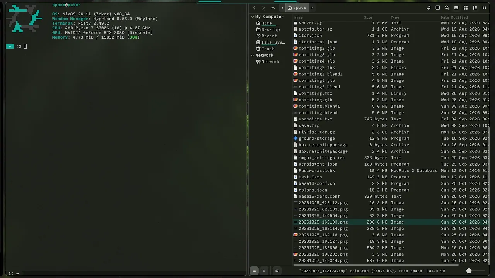

### Building

Dependencies are:
```
fontconfig
libxkbcommon
wayland
vulkan-loader
```
build with `cargo build --release`

### Support

Paperwing supports the following:
- Niri
- MangoWM
- Hyprland

More may be added in the future

### For NixOS/Home manager
Add the flake as an input
```nix
paperwing = {
  url = "github:Spaceey1/PaperWing";
  inputs.nixpkgs.follows = "nixpkgs"; #optional
};
```
Then add it as a NixOS package in your packages list.
```nix
environment.systemPackages = [
  inputs.paperwing.packages.${pkgs.stdenv.hostPlatform.system}.default
];
```
Or in home manager
```nix
home.packages = [
  inputs.paperwing.packages.${pkgs.stdenv.hostPlatform.system}.default
];
```
If you want stylix integration, import the home manager module and set `programs.paperwing.enable = true`:
```nix
imports = [ inputs.paperwing.homeModules.default ];
```

Remember to pass in inputs or the PaperWing flake as params to your modules.

If you don't feel like changing your configuration you can also try it out with just
```
nix run github:Spaceey1/PaperWing
```
